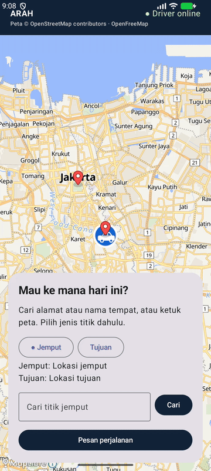
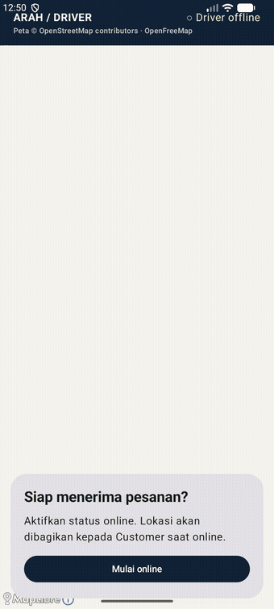
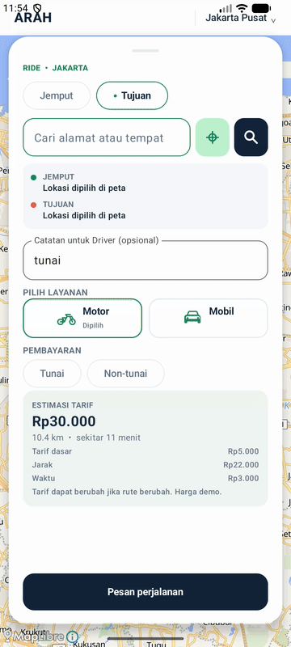
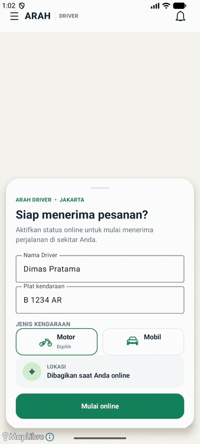

# ArahRide — Native Android

ArahRide contains two Android apps with separate application IDs:

- **:customer** → **Arah**, for creating and tracking orders.
- **:driver** → **Arah Driver**, for going online, accepting orders, marking arrival, and starting and completing rides.
- **:core** → shared models, HTTP/WebSocket communication, MapLibre maps, and UI panels.

The native MapLibre map is placed in an XML layout so it remains in the Android view system. Status panels and buttons use Jetpack Compose. Demo map data comes from OpenStreetMap through [OpenFreeMap](https://openfreemap.org/quick_start/); attribution is visible at the top of the screen.
The map supports pinch-to-zoom gestures.

Preview: [Driver screen with the car icon](docs/live-car.png).

## Booking flow demo

The GIFs below show the **Customer** flow (selecting pickup and destination points on the map, placing an order, and tracking the Driver until the ride starts) and the **Driver** flow (going online, accepting an order, arriving, verifying a PIN, and starting the ride) in the Android Dev/Portfolio app:

<table>
  <tr>
    <td align="center" valign="top" width="50%">
       
      <b>Customer</b> — book and track a ride
    </td>
    <td align="center" valign="top" width="50%">
       
      <b>Driver</b> — go online, accept a booking, and complete a ride
    </td>
  </tr>
</table>

## Production version

The **Production** app has a more complete flow than Dev/Portfolio: OTP login with a phone number, service selection (motorcycle/car) and payment method selection (cash/non-cash), fare estimates, non-cash payments, Driver ratings, and tips. This repository contains the **Dev/Portfolio** version. The clips below show the **Production Customer** and **Driver** apps for reference:

<table>
  <tr>
    <td align="center" valign="top" width="50%">
       
      <b>Production Customer</b> — order → ride → payment → tip
    </td>
    <td align="center" valign="top" width="50%">
       
      <b>Production Driver</b> — online → accept → arrive → PIN → ride
    </td>
  </tr>
</table>

## Tech stack

- **Language:** Kotlin
- **UI:** Jetpack Compose (panels and header) + XML layout (MapLibre map host)
- **Maps:** MapLibre Native with OpenFreeMap tiles (OpenStreetMap)
- **Networking:** OkHttp — HTTP (REST) and WebSocket for live snapshots
- **Location:** Android LocationManager + foreground service (Driver)
- **Build:** Gradle (Kotlin DSL), minSdk 26, targetSdk 35, JDK 17
- **Modules:** :core (models, RideClient, shared UI panels), :customer, :driver

## Getting started

1. Run [Arah Ride Backend Dev](https://github.com/alphadevthasa/arah-ride-backend-dev).
2. Open this folder in Android Studio. Run customer and driver on the same or separate Android emulators.
3. In Arah Driver, tap **Go Online** and allow location access. In Arah, select pickup and destination points by tapping the map, then place an order. Return to Driver to accept and complete the ride.
4. To build from the terminal: ./gradlew :customer:assembleDebug :driver:assembleDebug.

The default API URL is http://10.0.2.2:18080, the host address from the Android emulator. For physical devices, set a URL that the device can reach:

~~~sh
./gradlew :customer:assembleDebug :driver:assembleDebug \
  -PAPI_BASE_URL=http://your-mac.local:18080 \
  -PMAP_STYLE_URL=https://tiles.openfreemap.org/styles/liberty
~~~

For physical devices, the demo server must use ARAH_ADDR=0.0.0.0:18080. Only use this on a trusted development network. Release builds disable cleartext HTTP; use an HTTPS endpoint.

## Flow and prototype limitations

Ride status: requested → accepted → arrived → in_progress → completed, with Customer cancellation allowed only before the ride starts. The demo backend retrieves road routes from OSRM, stores the geometry with the order, and both apps render it as a polyline. Driver location comes from LocationManager every 3 seconds or after moving 5 meters, is sent to the backend, and is then relayed over WebSocket. When the Driver taps **Start Ride**, the backend sends simulated location updates every 100 ms for 16 seconds along the polyline; device location updates are paused during the simulation. The car icon moves along the route; the **View Driver Location** button moves the Customer map to the latest location. A foreground location service with a notification keeps sending updates while the Android Driver app is in the background.

The demo server supports only one Driver and one active order, with no accounts, payments, fares, multi-Driver dispatch, road navigation, or persistent storage. Map points are coordinates; address geocoding and route estimates are not available in this version. Before release, add authentication, per-order authorization, a database, Driver distribution, APNs/FCM for offers when the app is inactive, and HTTPS endpoints. Replace the demo tile provider with an SLA-backed OSM provider or your own tile server based on expected load. Do not direct commercial apps to the public tile.openstreetmap.org server.

## Place search verification results (2026-06-28)

- Automated: Android: ./gradlew :core:testDebugUnitTest :customer:assembleDebug :driver:assembleDebug passed (19 unit tests).
- With a local mock Photon server (ARAH_GEOCODER_URL), the backend mapped /v1/places/search and /v1/places/reverse results correctly; an empty query returned 400.
- **Not verified:** The public Photon service (photon.komoot.io) was unreachable from this machine during testing (the backend returned a generic 502), so real Indonesian address/POI search and production availability were not tested. End-to-end emulator/simulator testing (select a point, create an order, show the label in the Driver app, and tap the map) has not been run.
